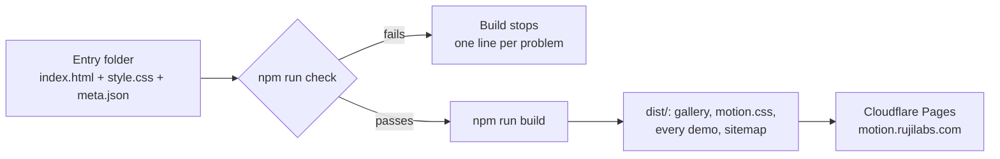

# Motion patterns

A credited collection of web motion: small CSS patterns and full scenes, each with a live demo, a reduced-motion state and a link to where it came from.

[](https://motion.rujilabs.com)
[](LICENSE)


<details>
<summary><strong>Table of contents</strong></summary>

- [Use one in a minute](#use-one-in-a-minute)
- [What is in here](#what-is-in-here)
- [Catalogue](#catalogue)
- [How the collection works](#how-the-collection-works)
- [Credits and sources](#credits-and-sources)
- [Run it locally](#run-it-locally)
- [Contributing](#contributing)
- [Documentation](#documentation)
- [Licence](#licence)

</details>

## Use one in a minute

Take the whole set as one file:

```html
<link rel="stylesheet" href="https://motion.rujilabs.com/motion.css">
<script src="https://motion.rujilabs.com/play.js"></script>  <!-- only for in-view patterns -->

<h1>Hello</h1>
<p class="rise">The heading is already there; the line under it rises in.</p>
```

Or copy one entry: [`tokens.css`](tokens.css) plus that entry's `style.css`. No build step, no package.

> [!TIP]
> Self-host the files for production. The hosted copy is fine for trying things out, but your page should not depend on someone else's server.

## What is in here

| Kind | What it is | Where |
|---|---|---|
| **Pattern** | One move: a class and a keyframe built on shared tokens | [`patterns/`](patterns/) |
| **Template** | A finished scene composed from patterns, ready to copy | [`templates/`](templates/) |
| **Tokens** | The shared easing curves, durations and stagger steps | [`tokens.css`](tokens.css) |
| **play.js** | Adds `.go` when an element scrolls into view (under 1 KB) | [`play.js`](play.js) |

Every entry follows the same rules:

- **Text renders first.** No heading or main image waits at `opacity: 0`.
- **Reduced motion shows the finished state**, never a blank one.
- **Content stays visible without JavaScript.** Hidden start states only apply once `play.js` has run.
- **CSP-safe.** No `style=""`, no inline scripts, no external requests.
- **Tokens only.** No raw `cubic-bezier()` outside [`tokens.css`](tokens.css).

## Catalogue

<!-- catalogue:start -->

| Entry | Kind | What it does | Tech | Credit | Source |
|---|---|---|---|---|---|
| [Crossfade](https://motion.rujilabs.com/patterns/crossfade/) | pattern | Stacked frames that take turns with no background flash. 2, 3 or 4 frames, an optional slow zoom on the image, and a pause toggle. | css | Original | [code](patterns/crossfade/) |
| [Draw](https://motion.rujilabs.com/patterns/draw/) | pattern | Lines that draw themselves: SVG strokes in sequence, a CSS-only text underline that wraps, and a link hover underline. No cap dot before the start. | css, svg | Original | [code](patterns/draw/) |
| [Drift](https://motion.rujilabs.com/patterns/drift/) | pattern | Ambient float on three cycles that share no factor, so the path never visibly repeats. Composes with existing transforms; phase and size controls. | css, svg | Original | [code](patterns/drift/) |
| [Fade](https://motion.rujilabs.com/patterns/fade/) | pattern | Opacity only, for images and backgrounds. A frame that removes the white flash and layout shift, a focus-settle for photos, and an in-view variant. | css, svg | Original | [code](patterns/fade/) |
| [Marquee](https://motion.rujilabs.com/patterns/marquee/) | pattern | An endless row with edge fades, reverse rows and a CSS-only pause toggle. Under reduced motion it stops and wraps so every item is readable. | css | Original | [code](patterns/marquee/) |
| [Paper diorama build](https://motion.rujilabs.com/patterns/paper/) | pattern | Flat SVG layers with a paper shadow and grain rise back to front, each landing with a small overshoot. | css, svg | Recreation of [@dikipirasaputra](https://www.threads.com/@dikipirasaputra) | [code](patterns/paper/) |
| [Pop](https://motion.rujilabs.com/patterns/pop/) | pattern | Springy scale-in on a real damped spring, with opacity done early. Variants for in-view, corner origins and a tactile button press. | css | Original | [code](patterns/pop/) |
| [Pulse](https://motion.rujilabs.com/patterns/pulse/) | pattern | A soft halo that beats then rests behind a status dot. A sonar variant for live states, a counted variant that stops, and a still ring under reduced motion. | css | Original | [code](patterns/pulse/) |
| [Scroll reveal](https://motion.rujilabs.com/patterns/reveal/) | pattern | Rise tied to scroll position with animation-timeline: view(). No script; unsupported browsers show the content. | css | Original | [code](patterns/reveal/) |
| [Rise](https://motion.rujilabs.com/patterns/rise/) | pattern | Entry from below with opacity landing early. Variants for in-view and a soft blur, plus a stagger capped at 8 steps. | css | Original | [code](patterns/rise/) |
| [Stamp](https://motion.rujilabs.com/patterns/stamp/) | pattern | Pressed onto the surface: accelerates in, squashes on contact, settles at a tilt. An ink variant for Paid or Approved seals, and in-view. | css | Original | [code](patterns/stamp/) |
| [Stretch and squeeze](https://motion.rujilabs.com/patterns/stretch-squeeze/) | pattern | Variable-width type: a headline settles from wide to condensed, and links widen on hover or focus. | css, variable-font | Original | [code](patterns/stretch-squeeze/) |
| [Paper diorama hero](https://motion.rujilabs.com/templates/paper-diorama-hero/) | template | A full-screen hero where a cut-paper landscape builds behind a headline that is readable from the first paint. Birds drift once the scene is built. | css, svg | Recreation of [@dikipirasaputra](https://www.threads.com/@dikipirasaputra) | [code](templates/paper-diorama-hero/) |
| [Squeeze headline](https://motion.rujilabs.com/templates/squeeze-headline/) | template | A shop hero where a wide headline settles condensed, an underline draws in, the copy rises and a category band loops below. | css, svg, variable-font | Original | [code](templates/squeeze-headline/) |
| [Stamp collage](https://motion.rujilabs.com/templates/stamp-collage/) | template | A menu board where paper scraps stamp on at a tilt, price stickers pop after each one, a live dot pulses and a shape drifts in the corner. | css, svg | Original | [code](templates/stamp-collage/) |

<!-- catalogue:end -->

## How the collection works

Each entry is a folder with a demo page, its CSS and a `meta.json`. The gate reads them all before every build.



A push to `main` runs the gate and the build on Cloudflare Pages; a failing build leaves the previous version live.

## Credits and sources

This is a collection, so most entries will come from somewhere else. `meta.json` records how:

| `relation` | Meaning | Code copied? |
|---|---|---|
| `original` | Made here | No source |
| `port` | Code copied from a source whose licence allows it (MIT, CC0, Apache 2.0, BSD, ISC, Unlicense), with its notice kept | Yes |
| `recreation` | Rebuilt from scratch after watching the source | No |
| `inspired-by` | The idea came from the source; the build is different | No |

> [!IMPORTANT]
> A post, video or shot with no licence is **not** free to copy. It can only come in as a `recreation` or `inspired-by` entry, written from scratch, with a credit link. The gate refuses a `port` whose licence is not on the list.

Found your work here without a credit, or want it removed? [Open a credit or removal request](https://github.com/rujilabs/motion-patterns/issues/new?template=credit-or-removal.yml).

## Run it locally

```bash
git clone https://github.com/rujilabs/motion-patterns.git
cd motion-patterns
npm run dev        # check + build + serve on http://localhost:4321
```

Node 20 or later. There is nothing to install.

## Contributing

New motions are welcome. Read [CONTRIBUTING.md](CONTRIBUTING.md), then either [suggest a motion](https://github.com/rujilabs/motion-patterns/issues/new?template=suggest-a-motion.yml) or open a pull request with a new entry folder.

## Documentation

| I want to | Read |
|---|---|
| Learn by building my first entry | [Tutorial: your first pattern](docs/tutorials/01-your-first-pattern.md) |
| Add an entry or credit a source | [How-to guides](docs/how-to/README.md) |
| Look up a token or a `meta.json` field | [Reference](docs/reference/README.md) |
| Understand why it is built this way | [Explanation and decisions](docs/explanation/README.md) |

## Licence

[MIT](LICENSE) for the code in this repository. The Anybody font is under the [SIL Open Font License](fonts/OFL.txt). Ported entries keep their source's notice.
