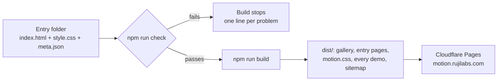

# Motion patterns

A credited collection of web motion: small CSS patterns and full scenes, each with a live demo, a reduced-motion state and a link to where it came from.

[](https://motion.rujilabs.com)
[](LICENSE)


<details>
<summary><strong>Table of contents</strong></summary>

- [Use one in a minute](#use-one-in-a-minute)
- [What is in here](#what-is-in-here)
- [Catalogue](#catalogue)
- [How the collection works](#how-the-collection-works)
- [Credits and sources](#credits-and-sources)
- [Run it locally](#run-it-locally)
- [Contributing](#contributing)
- [Documentation](#documentation)
- [Licence](#licence)

</details>

## Use one in a minute

Take the whole set as one file:

```html
<link rel="stylesheet" href="https://motion.rujilabs.com/motion.css">
<script src="https://motion.rujilabs.com/play.js"></script>  <!-- only for in-view patterns -->

<h1>Hello</h1>
<p class="rise">The heading is already there; the line under it rises in.</p>
```

Need only one kind of move? Each category has its own file under 10 KB gzipped, for example `motion-state.css`, `motion-transition.css`, `motion-camera.css`, `motion-look.css`, or one of the object families such as `motion-gear.css`, `motion-drum.css` or `motion-globe.css` (the categories are listed in [`meta.json`](docs/reference/meta-json.md)).

Or copy one entry: [`tokens.css`](tokens.css) plus that entry's `style.css`. No build step, no package.

> [!TIP]
> Self-host the files for production. The hosted copy is fine for trying things out, but your page should not depend on someone else's server.

## What is in here

| Kind | What it is | Where |
|---|---|---|
| **Pattern** | One move: a class and a keyframe built on shared tokens | [`patterns/`](patterns/) |
| **Template** | A finished scene composed from patterns, ready to copy | [`templates/`](templates/) |
| **Tokens** | The shared easing curves, durations and stagger steps | [`tokens.css`](tokens.css) |
| **play.js** | Adds `.go` when an element scrolls into view (under 1 KB); also the fallback for `.reveal` where scroll timelines are missing | [`play.js`](play.js) |
| **Entry READMEs** | Every entry folder has its own README: use, variants, do and do not, reduced motion | e.g. [`patterns/rise/`](patterns/rise/) |

Every entry follows the same rules:

- **Text renders first.** No heading or main image waits at `opacity: 0`.
- **Reduced motion shows the finished state**, never a blank one.
- **Content stays visible without JavaScript.** Hidden start states only apply once `play.js` has run.
- **CSP-safe.** No `style=""`, no inline scripts, no external requests.
- **Tokens only.** No raw `cubic-bezier()` outside [`tokens.css`](tokens.css).
- **Pausable.** Anything that moves on its own for more than 5 seconds has a pause control.
- **Hands-on means every hand.** A control you drag or turn also works by touch and by keyboard, with the right ARIA role.

Categories come in two kinds. Most say **what the motion does** (`entry`, `scroll`, `state`, `transition`, ...). Eleven say **what object moves**: `curve`, `morph`, `tile`, `solid`, `gear`, `panel`, `light`, `wave`, `globe`, `drum` and `form`. Each object-family entry is built around one real job (a booking time wheel, a shipping country globe, a bank transfer lever), its README starts with a `Use when:` line, and no job appears twice in the collection.

## Catalogue

<!-- catalogue:start -->

| Entry | Kind | What it does | Tech | Credit | Source |
|---|---|---|---|---|---|
| [Animated gradient](https://motion.rujilabs.com/patterns/animated-gradient/) | pattern | A slow mesh gradient: four soft colour fields drift on long, unequal loops over a base colour. Transform only, no blur filter, with a CSS-only pause toggle. | css |  | [code](patterns/animated-gradient/) |
| [Anticipation](https://motion.rujilabs.com/patterns/anticipation/) | pattern | A small wind-up the opposite way, a beat of stillness, then the main move speeding away. Set by a destination and a share, started by a class or in view. | css, js |  | [code](patterns/anticipation/) |
| [Backlighting](https://motion.rujilabs.com/patterns/backlight/) | pattern | The light sits behind the subject: a glow rises on the wall, a halo wraps the outline and the front falls into soft shade. One class on a cut-out subject. | css, svg |  | [code](patterns/backlight/) |
| [Badge](https://motion.rujilabs.com/patterns/badge/) | pattern | A count badge that springs in from its corner, bumps and rolls its digits up or down when the number changes, and drops out fast at zero. | css, js |  | [code](patterns/badge/) |
| [Bars and count-up](https://motion.rujilabs.com/patterns/bars/) | pattern | Bars spring up from the baseline and each value rides the top of its own bar while it counts up. Vertical and horizontal, with an optional marked rule. | css |  | [code](patterns/bars/) |
| [Before and after slider](https://motion.rujilabs.com/patterns/before-after/) | pattern | Two pictures in one frame with a divider you drag to compare. A native range input drives it, and the divider nudges once when it comes into view. | css, js |  | [code](patterns/before-after/) |
| [Black and white](https://motion.rujilabs.com/patterns/black-and-white/) | pattern | Colour drains out to greys through a saturation blend layer. A held colour accent variant keeps one object in colour above the grade. | css, svg |  | [code](patterns/black-and-white/) |
| [Blinds transition](https://motion.rujilabs.com/patterns/blinds/) | pattern | The next view appears through slats like window blinds: bands that widen until they meet, or solid slats that turn shut on their long axis and open again on the new view. | css, js |  | [code](patterns/blinds/) |
| [Blue hour](https://motion.rujilabs.com/patterns/blue-hour/) | pattern | After sunset: the scene cools to deep blue, then warm windows and a street lamp switch on one by one. A grade class plus a light layer that stays warm. | css, svg |  | [code](patterns/blue-hour/) |
| [Bokeh](https://motion.rujilabs.com/patterns/bokeh/) | pattern | Points of light open into soft discs with a brighter rim and drift slowly behind a sharp subject, while the background goes soft. CSS only, with a pause toggle. | css, svg |  | [code](patterns/bokeh/) |
| [Bottom sheet](https://motion.rujilabs.com/patterns/bottom-sheet/) | pattern | A sheet rises from the bottom to a half detent. Drag the grip to full or down to close; a quick flick throws further, and it settles on the paper curve with a slight landing. | css, js |  | [code](patterns/bottom-sheet/) |
| [Bounce](https://motion.rujilabs.com/patterns/bounce/) | pattern | Dropped from above, it bounces lower each time until it rests: true parabolas with each bounce a quarter as high. A soft one-bounce variant for badges, and in-view. | css, js |  | [code](patterns/bounce/) |
| [Breadcrumbs](https://motion.rujilabs.com/patterns/breadcrumbs/) | pattern | A trail that opens room for each new crumb and slides its label in as you go deeper, then folds back from the end, last crumb first, when you climb up. | css, js |  | [code](patterns/breadcrumbs/) |
| [Burst](https://motion.rujilabs.com/patterns/burst/) | pattern | Dots or paper slips fly out from a like or a done tick and fade, while the icon gives one springy beat. CSS only, replays each time the box is checked. | css |  | [code](patterns/burst/) |
| [Butterfly lighting](https://motion.rujilabs.com/patterns/butterfly-lighting/) | pattern | Light high and straight in front: the forehead brightens and a small butterfly shadow drops under the nose, with a soft one under the chin. One class on any portrait. | css, svg |  | [code](patterns/butterfly-lighting/) |
| [Camera zoom](https://motion.rujilabs.com/patterns/camera-zoom/) | pattern | A lens zoom: the whole flat frame scales toward one point, near and far by the same amount, so nothing slides past anything else. Set the point and the end scale. | css, svg |  | [code](patterns/camera-zoom/) |
| [Card flip](https://motion.rujilabs.com/patterns/card-flip/) | pattern | A card turns over in 3D to show its back and lands with a slight overshoot. Hover and focus, button or checkbox triggers, and a turn over the top edge. | css, js |  | [code](patterns/card-flip/) |
| [Carousel](https://motion.rujilabs.com/patterns/carousel/) | pattern | Slides on native scroll snap, moved by swipe, keys or buttons. The centred slide grows to full size while its neighbours sit back, and the current dot stretches into a bar. | css, js, svg |  | [code](patterns/carousel/) |
| [Chromatic aberration](https://motion.rujilabs.com/patterns/chromatic-aberration/) | pattern | Red and blue fringes split along dark edges and grow toward the corners: three colour channel copies scaled by slightly different amounts. CSS blend modes only. | css, svg |  | [code](patterns/chromatic-aberration/) |
| [Crane up](https://motion.rujilabs.com/patterns/crane-up/) | pattern | The camera rises and tips down to show a scene from above that was hidden at eye level. Real CSS 3D: a perspective frame and a rig that lifts and turns about the ground. | css |  | [code](patterns/crane-up/) |
| [Crossfade](https://motion.rujilabs.com/patterns/crossfade/) | pattern | Stacked frames that take turns with no background flash. 2, 3 or 4 frames, an optional slow zoom on the image, and a pause toggle. | css |  | [code](patterns/crossfade/) |
| [Cube transition](https://motion.rujilabs.com/patterns/cube/) | pattern | Four views sit on the side faces of a 3D cube that turns a quarter to bring the next one round, with a slight dip back mid-turn. Side or top axis. | css, js |  | [code](patterns/cube/) |
| [Cursor follower](https://motion.rujilabs.com/patterns/cursor-follower/) | pattern | A soft dot trails the mouse with a short lag and opens into a ring over links. The real cursor stays; touch, pen and reduced motion get no dot. | css, js |  | [code](patterns/cursor-follower/) |
| [Curve arc picker](https://motion.rujilabs.com/patterns/curve-arc-picker/) | pattern | A size picker whose options ride the top of a wheel. Swipe and throw it, tap an option or use the keys; a spring catches the nearest one, which rises off the arc with a deeper shadow. | css, js |  | [code](patterns/curve-arc-picker/) |
| [Curve connector](https://motion.rujilabs.com/patterns/curve-connector/) | pattern | A workflow board where curved connectors stay attached to both ends of the steps you drag. The control points ride springs, so a fast drag swings the curve and it settles like a cable. | css, svg, js |  | [code](patterns/curve-connector/) |
| [Curve easing editor](https://motion.rujilabs.com/patterns/curve-easing-editor/) | pattern | A cubic-bezier editor with two real handles, keyboard nudging and a live spacing chart. It writes the CSS value, and a preview dot replays the curve each time you let go. | css, svg, js |  | [code](patterns/curve-easing-editor/) |
| [Curve route](https://motion.rujilabs.com/patterns/curve-route/) | pattern | An order tracking map: the delivery route draws from the shop to the door, stops pop as the line reaches them, and a van rides the curve to its current stop, turning with every bend. | css, svg, js |  | [code](patterns/curve-route/) |
| [Curve signature](https://motion.rujilabs.com/patterns/curve-signature/) | pattern | An e-sign pad whose ink thins with pen speed and pools in slow turns, smoothed like pressure. Clear rewinds the pen: the ink un-draws, newest stroke first, back to an empty line. | css, canvas, js |  | [code](patterns/curve-signature/) |
| [3D bars](https://motion.rujilabs.com/patterns/data-bars-3d/) | pattern | Bars as real CSS 3D prisms with a lit top, front and shaded side. They grow from the floor one quarter after another as the chart scrolls into view, casting a shadow that lengthens. | css, js |  | [code](patterns/data-bars-3d/) |
| [Live candles](https://motion.rujilabs.com/patterns/data-candles/) | pattern | A live candlestick chart. The forming candle stretches its body and wick with every tick, closed candles slide left as a new one opens, and the scale eases only when it must. | css, js |  | [code](patterns/data-candles/) |
| [Funnel drop-off](https://motion.rujilabs.com/patterns/data-funnel/) | pattern | A sales funnel that fills one stage at a time. Each bar arrives at the width of the stage before and narrows to its own, leaving the people who dropped off as a hatched band. | css, js |  | [code](patterns/data-funnel/) |
| [Live poll results](https://motion.rujilabs.com/patterns/data-poll-results/) | pattern | Live poll bars you can vote in. Bursts of votes ease every bar to its new share, a small +n rises on the options that gained, and the percentages always add up to 100. | css, js |  | [code](patterns/data-poll-results/) |
| [Live sparkline](https://motion.rujilabs.com/patterns/data-sparkline-live/) | pattern | A small live line that takes a new reading each second and scrolls left at a steady speed, with a dot riding the right edge. It turns to the warning colour over its limit. | svg, js |  | [code](patterns/data-sparkline-live/) |
| [Depth parallax](https://motion.rujilabs.com/patterns/depth-parallax/) | pattern | Layers at different depths shift by different amounts, following the pointer or drifting in a slow loop with a pause toggle, so a flat scene reads as near and far. | css, svg, js |  | [code](patterns/depth-parallax/) |
| [Accordion and tabs](https://motion.rujilabs.com/patterns/disclose/) | pattern | Native details that open to their real height while the plus folds into a minus, and tabs whose ink moves like an inchworm: the leading edge first, the trailing edge a beat later. | css, js |  | [code](patterns/disclose/) |
| [Dolly in](https://motion.rujilabs.com/patterns/dolly-in/) | pattern | The camera travels toward the subject: near layers grow fast and slide out of frame, far layers barely change. Set --depth per layer; the parallax is what a zoom lacks. | css, svg |  | [code](patterns/dolly-in/) |
| [Dolly zoom](https://motion.rujilabs.com/patterns/dolly-zoom/) | pattern | The vertigo effect: the subject keeps its size while the space behind it stretches and squeezes. Layers scale about the vanishing point by their --depth; the subject stays still. | css, svg |  | [code](patterns/dolly-zoom/) |
| [Donut and gauge](https://motion.rujilabs.com/patterns/donut/) | pattern | One pen draws the whole donut, lifting at each gap, while the total counts on the same clock. A gauge needle swings past and settles. No script. | css, svg |  | [code](patterns/donut/) |
| [Double exposure](https://motion.rujilabs.com/patterns/double-exposure/) | pattern | A second picture in screen blend mode over a dark subject on a light ground, so it shows only inside the silhouette. It fades in and settles. | css, svg |  | [code](patterns/double-exposure/) |
| [Draw](https://motion.rujilabs.com/patterns/draw/) | pattern | Lines that draw themselves: SVG strokes in sequence, a CSS-only text underline that wraps, and a link hover underline. No cap dot before the start. | css, svg |  | [code](patterns/draw/) |
| [Drawer](https://motion.rujilabs.com/patterns/drawer/) | pattern | An off-canvas panel on a native dialog slides in from the side over a scrim and leaves faster than it came. Optionally the page shifts a short way aside, or it stays still. | css, js |  | [code](patterns/drawer/) |
| [Drift](https://motion.rujilabs.com/patterns/drift/) | pattern | Ambient float on three cycles that share no factor, so the path never visibly repeats. Composes with existing transforms; phase and size controls. | css, svg |  | [code](patterns/drift/) |
| [Dropdown](https://motion.rujilabs.com/patterns/dropdown/) | pattern | A menu that unfolds out of the corner nearest its trigger, opening up or down by the room it has, then lets its items arrive a short step apart. It closes quicker and all at once. | css, js |  | [code](patterns/dropdown/) |
| [Drum combo lock](https://motion.rujilabs.com/patterns/drum-combo-lock/) | pattern | A padlock with four 3D number dials that click into each digit. Turn them to the code and the shackle lifts and swings open to reveal what is inside. | css, js |  | [code](patterns/drum-combo-lock/) |
| [Drum rolodex](https://motion.rujilabs.com/patterns/drum-rolodex/) | pattern | A rotary card file in 3D. Cards hang on one axle and flip over it as you scroll, drag or flick, landing on a card. Type a letter to spin to it. | css, js |  | [code](patterns/drum-rolodex/) |
| [Drum slot voucher](https://motion.rujilabs.com/patterns/drum-slot-voucher/) | pattern | Pull the lever and three 3D reels kick back, spin up, then brake one by one and settle against the stopper on a voucher code. | css, js |  | [code](patterns/drum-slot-voucher/) |
| [Drum time picker](https://motion.rujilabs.com/patterns/drum-time-picker/) | pattern | Hour, minute and am or pm wheels on real 3D cylinders. Flick one and it glides with your speed, then lands on a slot. Drag, tap, wheel or arrow keys. | css, js |  | [code](patterns/drum-time-picker/) |
| [Drum word rotator](https://motion.rujilabs.com/patterns/drum-word-rotator/) | pattern | A headline word on a row of three-sided prisms, like a roadside tri-vision sign. The slats turn one after another and the next word comes round, shaded as it turns. | css, js |  | [code](patterns/drum-word-rotator/) |
| [Duotone](https://motion.rujilabs.com/patterns/duotone/) | pattern | The picture maps to two colours, dark and light, with blend layers. A cycle variant moves slowly through three colour pairs, with a CSS-only pause toggle. | css, svg |  | [code](patterns/duotone/) |
| [Dutch angle](https://motion.rujilabs.com/patterns/dutch-angle/) | pattern | The frame rolls to a canted angle to signal tension, holds, and levels again. It scales while it turns so no corner shows. Loop, roll once on view, or cant on hover. | css |  | [code](patterns/dutch-angle/) |
| [Easing](https://motion.rujilabs.com/patterns/easing/) | pattern | The same move on linear, ease-out, ease-in, ease-in-out and spring, side by side with each curve drawn, plus classes that hand any element one of the shared curves. | css |  | [code](patterns/easing/) |
| [Empty state](https://motion.rujilabs.com/patterns/empty-state/) | pattern | When a list is empty, its picture comes down and lands with a slight give while its shadow grows, an accent springs in, strokes draw on, and the message and action rise after. | css, svg |  | [code](patterns/empty-state/) |
| [Exit-intent popup](https://motion.rujilabs.com/patterns/exit-intent/) | pattern | A native dialog that drops in once per visit when the mouse leaves through the top of the page, and lifts away on close. Touch never triggers it. | css, js |  | [code](patterns/exit-intent/) |
| [Exploded view](https://motion.rujilabs.com/patterns/exploded-view/) | pattern | An object drawn as flat isometric layers lifts apart along its vertical axis, labels slide out beside each layer, then it closes up again. A loop with a pause, or held open by a class. | css |  | [code](patterns/exploded-view/) |
| [Fade](https://motion.rujilabs.com/patterns/fade/) | pattern | Opacity only, for images and backgrounds. A frame that removes the white flash and layout shift, a focus-settle for photos, and an in-view variant. | css, svg |  | [code](patterns/fade/) |
| [Film grain](https://motion.rujilabs.com/patterns/film-grain/) | pattern | A fine noise texture in overlay blend mode that jumps to a new place about 12 times a second. Self-contained in one CSS file, with a pause toggle. | css, svg |  | [code](patterns/film-grain/) |
| [Filter chips](https://motion.rujilabs.com/patterns/filter-chips/) | pattern | Checkboxes drawn as chips. Turning one on widens it smoothly to open a slot, and a check mark grows in and draws itself there. CSS only. | css, svg |  | [code](patterns/filter-chips/) |
| [Fisheye](https://motion.rujilabs.com/patterns/fisheye/) | pattern | A true barrel distortion for SVG drawings: the middle swells, straight lines bow outward and the corners fall off. Tweened point by point with the Web Animations API. | css, svg, js |  | [code](patterns/fisheye/) |
| [Follow-through](https://motion.rujilabs.com/patterns/follow-through/) | pattern | The body stops, its loose parts carry on: an antenna lags, swings past and settles in shrinking swings while the body rocks on its wheels. One clock for body and parts. | css, svg, js |  | [code](patterns/follow-through/) |
| [Variable font axes](https://motion.rujilabs.com/patterns/font-axis/) | pattern | Weight, width and slant axes as registered custom properties: a hover that turns heavier and leaning, a breathing loop and a ripple through the letters. Missing axes are skipped. | css, variable-font |  | [code](patterns/font-axis/) |
| [Check cube](https://motion.rujilabs.com/patterns/form-check-cube/) | pattern | A checkbox that turns over like a cube: the ticked face rolls forward to the front, faces shade as they turn from the light, and the task text is struck through. | css, svg, js |  | [code](patterns/form-check-cube/) |
| [Keycap](https://motion.rujilabs.com/patterns/form-keycap/) | pattern | A button built like a keycap on a switch. Pressing sinks the cap so its skirt slides behind the plate edge, and a real key on the keyboard presses it too. | css, js |  | [code](patterns/form-keycap/) |
| [Lever confirm](https://motion.rujilabs.com/patterns/form-lever-confirm/) | pattern | Pull a lever all the way down to confirm a big action. The arm has mass, latches at the bottom, and springs back against its stop if you let go early. Keys and taps work too. | css, svg, js |  | [code](patterns/form-lever-confirm/) |
| [Rocker switch](https://motion.rujilabs.com/patterns/form-rocker-switch/) | pattern | A checkbox drawn as a rocker switch that tips about its pivot. The raised half catches the light, the lamp lights mid-throw, and the paddle snaps over centre into its stop. | css, js |  | [code](patterns/form-rocker-switch/) |
| [Rotary knob](https://motion.rujilabs.com/patterns/form-rotary-knob/) | pattern | A knob with detents on an arc scale, as an ARIA slider. Drag around it or use the keys; it clicks from notch to notch and springs into place, under a light that stays put. | css, svg, js |  | [code](patterns/form-rotary-knob/) |
| [FPV flight](https://motion.rujilabs.com/patterns/fpv-flight/) | pattern | A fast, low fly-through: a 3D ground plane streams toward the camera, things beside the route grow and sweep past, and the whole view banks into turns. CSS only, with a pause toggle. | css |  | [code](patterns/fpv-flight/) |
| [Freeze frame](https://motion.rujilabs.com/patterns/freeze-frame/) | pattern | The action stops on its key frame, a flash goes off, the colour drains and a label lands, then the action runs on. A small script stops your own CSS animations exactly on the frame. | css, svg, js |  | [code](patterns/freeze-frame/) |
| [Gear processing](https://motion.rujilabs.com/patterns/gear-processing/) | pattern | Meshing gears turn while a job runs, each at a speed set by its tooth count, then spin down as the file is ready. A progress counter reads its value off the gears. | svg, js |  | [code](patterns/gear-processing/) |
| [Gear rack progress](https://motion.rujilabs.com/patterns/gear-rack-progress/) | pattern | A reading-progress bar where scrolling turns a pinion that drives a toothed rack out across the top. One rack pitch per tooth, so they never slip, and the rack trails on a spring. | svg, js |  | [code](patterns/gear-rack-progress/) |
| [Gear sale countdown](https://motion.rujilabs.com/patterns/gear-sale-countdown/) | pattern | A flash-sale countdown ticked by a clock escapement: each second the pendulum swings, a pallet lets go, the 30-tooth wheel drops half a tooth with a recoil, and the digits change on the drop. | svg, js |  | [code](patterns/gear-sale-countdown/) |
| [Gear settings icon](https://motion.rujilabs.com/patterns/gear-settings-icon/) | pattern | A two-cog settings icon turns one tooth on hover or focus and two when its panel opens, back two when it closes. The meshed small cog turns the other way, faster, and every turn lands on a spring. | svg, js |  | [code](patterns/gear-settings-icon/) |
| [Gear world clock](https://motion.rujilabs.com/patterns/gear-world-clock/) | pattern | One gear train drives a clock per city. Turn any wheel or use the arrow keys to set a meeting time; idlers keep every clock turning the same way at the same speed, and night dials go dark. | svg, js |  | [code](patterns/gear-world-clock/) |
| [Glitch](https://motion.rujilabs.com/patterns/glitch/) | pattern | A broken signal in short bursts: jitter, two colour copies split to the sides and slices jumping sideways, on text or an image. Loops with a pause toggle, or once on hover. | css |  | [code](patterns/glitch/) |
| [Globe country picker](https://motion.rujilabs.com/patterns/globe-country-picker/) | pattern | A dot globe turns the short way round, on a great circle, to the country picked in a shipping form, then its land lights up and a pin lands. Drag or flick it to turn it by hand. | canvas, js |  | [code](patterns/globe-country-picker/) |
| [Globe day and night](https://motion.rujilabs.com/patterns/globe-day-night/) | pattern | A dot globe lit by the real sun for a set date and hour, with the day and night line where it truly falls. Drag the hour to sweep it, drag the globe to turn it. | canvas, js |  | [code](patterns/globe-day-night/) |
| [Globe flight arcs](https://motion.rujilabs.com/patterns/globe-flight-arcs/) | pattern | Routes lift off a dot globe as great-circle arcs, longer flights climbing higher, and a plane rides each one with its shadow on the ground below. Plays when it scrolls into view. | canvas, js |  | [code](patterns/globe-flight-arcs/) |
| [Globe live dots](https://motion.rujilabs.com/patterns/globe-live-dots/) | pattern | Live visitors as dots on a globe: each place sized by how many people are there now and sending out rings, busy places more often. Dots ease to new sizes when the counts change. | canvas, js |  | [code](patterns/globe-live-dots/) |
| [Globe text band](https://motion.rujilabs.com/patterns/globe-text-band/) | pattern | A line of text printed on a ribbon wraps a turning dot globe. The ribbon winds on, its far half passes behind the ball, and letters narrow as they turn away. | canvas, js |  | [code](patterns/globe-text-band/) |
| [Golden hour](https://motion.rujilabs.com/patterns/golden-hour/) | pattern | The sun lowers, the scene grades into warm gold and the shadows stretch long. A grade class for any image, plus helpers for a sun and shadows you draw. | css, svg |  | [code](patterns/golden-hour/) |
| [Hamburger menu](https://motion.rujilabs.com/patterns/hamburger/) | pattern | Three bars fold into an X in two beats (slide together, then turn) while the menu unfolds from its top edge and the items drop in one after another. | css, js |  | [code](patterns/hamburger/) |
| [Handheld](https://motion.rujilabs.com/patterns/handheld/) | pattern | A small organic sway of the whole frame, as if the camera is held by hand: two loops of different lengths that never line up. Calm and walking variants, a pause toggle. | css |  | [code](patterns/handheld/) |
| [High-key](https://motion.rujilabs.com/patterns/high-key/) | pattern | The scene grades to bright, soft, low-contrast tones that sit near white. A class for any image or section: a flattening filter and a white wash. | css, svg |  | [code](patterns/high-key/) |
| [Highlighter](https://motion.rujilabs.com/patterns/highlighter/) | pattern | A marker stroke sweeps behind words when they come into view. A background on the text, so it wraps across lines; a low underline variant and per-mark delays. | css |  | [code](patterns/highlighter/) |
| [Horizontal scroll](https://motion.rujilabs.com/patterns/horizontal-scroll/) | pattern | Vertical scrolling drives a row of panels sideways while the section holds, with a progress line. CSS scroll timelines only; a swipeable snapping row where they are missing. | css |  | [code](patterns/horizontal-scroll/) |
| [Hover lift](https://motion.rujilabs.com/patterns/hover-lift/) | pattern | Cards rise a few pixels on hover while a long soft shadow grows under them, then press down fast on click and spring back on release. | css |  | [code](patterns/hover-lift/) |
| [Image zoom on hover](https://motion.rujilabs.com/patterns/image-zoom/) | pattern | The picture grows slowly inside a frame that keeps its size, so the layout stays still and only the view moves closer. Slow in, quicker out. | css |  | [code](patterns/image-zoom/) |
| [Infinite scroll](https://motion.rujilabs.com/patterns/infinite-scroll/) | pattern | Near the end of a list a loader turns, then the next batch arrives one item after another. A Load more button stays as the keyboard path, and the end is announced. | css, js |  | [code](patterns/infinite-scroll/) |
| [J-cut](https://motion.rujilabs.com/patterns/j-cut/) | pattern | The next scene's sound starts before its picture: a caption and level meter for scene B arrive while A is still on screen, then the picture follows. Timeline playhead and pause toggle. | css, svg |  | [code](patterns/j-cut/) |
| [Jump cut](https://motion.rujilabs.com/patterns/jump-cut/) | pattern | Near-identical framings of the same subject cut together with no transition, so time jumps forward. Step-end keyframes, an optional punch-in on every second frame, and a pause toggle. | css, svg |  | [code](patterns/jump-cut/) |
| [Kaleidoscope](https://motion.rujilabs.com/patterns/kaleidoscope/) | pattern | One thin slice of a picture, drawn and animated once, then mirrored and turned into a twelve-fold circle. The slice drifts, the circle turns, and a CSS toggle pauses both. | svg, js, css |  | [code](patterns/kaleidoscope/) |
| [Kinetic type](https://motion.rujilabs.com/patterns/kinetic-type/) | pattern | A headline built word by word on one beat (rise, slide, slam), ending in a word slot that keeps swapping 2 to 5 words, with a CSS-only pause toggle. | css |  | [code](patterns/kinetic-type/) |
| [L-cut](https://motion.rujilabs.com/patterns/l-cut/) | pattern | The previous scene's sound keeps going over the next scene's picture: the picture cuts, and scene A's caption and level meter run on before B's sound takes over. Timeline playhead and pause toggle. | css, svg |  | [code](patterns/l-cut/) |
| [Lazy loading](https://motion.rujilabs.com/patterns/lazy-load/) | pattern | Blur-up lazy images: a colour placeholder with a soft loading light, then the real picture sharpens and fades in over it once it has loaded near the view. | css, js |  | [code](patterns/lazy-load/) |
| [Lens flare](https://motion.rujilabs.com/patterns/lens-flare/) | pattern | A bright light throws a row of soft discs and rings through the frame centre; as the light moves the row swings with it. Animated registered custom properties, CSS only. | css |  | [code](patterns/lens-flare/) |
| [Light card sheen](https://motion.rujilabs.com/patterns/light-card-sheen/) | pattern | A member card that tilts under the pointer and mirrors a strip light: the highlight's place and angle come from a real reflection, foil catches it sharper, and the face darkens as it turns away. | css, svg, js |  | [code](patterns/light-card-sheen/) |
| [Light leak](https://motion.rujilabs.com/patterns/light-leak/) | pattern | Two warm translucent washes drift slowly in and out at the frame edges in screen blend mode. CSS only, with a pause toggle and a still variant. | css, svg |  | [code](patterns/light-leak/) |
| [Light open sign](https://motion.rujilabs.com/patterns/light-open-sign/) | pattern | A neon OPEN sign on a simulated clock. In opening hours it strikes like real neon: fast flickers, a dead gap, one weak letter late, then steady. Out of hours it is clear glass. | svg, js |  | [code](patterns/light-open-sign/) |
| [Light pointer spotlight](https://motion.rujilabs.com/patterns/light-pointer-spotlight/) | pattern | A lamp follows the pointer over a feature grid. Its pool of light falls off like a real point light, lands on cards, edges and gaps alike, and lifts away dimmer and wider when you leave. | css, js |  | [code](patterns/light-pointer-spotlight/) |
| [Light pull cord](https://motion.rujilabs.com/patterns/light-pull-cord/) | pattern | A theme switch you pull: a ball chain on a sprung switch. Drag the handle down, it clicks at 9 px, and on release the chain is yanked up, falls slack and bounces taut. | css, svg, js |  | [code](patterns/light-pull-cord/) |
| [Light scan verify](https://motion.rujilabs.com/patterns/light-scan-verify/) | pattern | A scanner lamp crosses an uploaded ID at carriage speed. Behind it the photo's uneven light is gone, each field gets a box as the line reaches it, and its check ticks a beat later. | css, js |  | [code](patterns/light-scan-verify/) |
| [Light sweep](https://motion.rujilabs.com/patterns/light-sweep/) | pattern | A band of light passes across a button, card or logo. One pass on hover or focus, one when it comes into view, or a slow repeat with a pause toggle. | css |  | [code](patterns/light-sweep/) |
| [Line and area](https://motion.rujilabs.com/patterns/line/) | pattern | A line chart drawn by a pen: the line draws itself, a dot rides the tip, the area is wiped in right under it, and notes land as the pen passes them. | css, svg, js |  | [code](patterns/line/) |
| [Line boil](https://motion.rujilabs.com/patterns/line-boil/) | pattern | A hand-drawn line that shimmers between three slightly different tracings, like animated pencil lines. Hard cuts, eight drawings a second, a CSS pause toggle. | svg, css |  | [code](patterns/line-boil/) |
| [Liquid blob](https://motion.rujilabs.com/patterns/liquid-blob/) | pattern | Drops pull out of one blob, travel and melt into the next, joined by an SVG goo filter that turns nearby circles into one liquid shape. Pausable. | css, svg |  | [code](patterns/liquid-blob/) |
| [Liquid transition](https://motion.rujilabs.com/patterns/liquid-transition/) | pattern | The next view floods in from the bottom behind a wavy edge made of two drifting waves, or pours down from the top. A CSS mask, removed when the run ends. | css, svg, js |  | [code](patterns/liquid-transition/) |
| [Long exposure](https://motion.rujilabs.com/patterns/long-exposure/) | pattern | Moving lights grow into smooth streaks at a steady speed while buildings and lamps stay sharp, then the frame clears for the next exposure. SVG paths, CSS only, with a pause toggle. | css, svg |  | [code](patterns/long-exposure/) |
| [Low-key](https://motion.rujilabs.com/patterns/low-key/) | pattern | The room falls dark and contrasty around one pool of light. A class for any image or section; place the pool with four custom properties. | css, svg |  | [code](patterns/low-key/) |
| [Magnetic button](https://motion.rujilabs.com/patterns/magnetic-button/) | pattern | A button drifts a few pixels toward a mouse that comes near, its label leaning a little further, and springs home when the pointer leaves. | css, js |  | [code](patterns/magnetic-button/) |
| [Marquee](https://motion.rujilabs.com/patterns/marquee/) | pattern | An endless row with edge fades, reverse rows and a CSS-only pause toggle. Under reduced motion it stops and wraps so every item is readable. | css |  | [code](patterns/marquee/) |
| [Mask reveal](https://motion.rujilabs.com/patterns/mask-reveal/) | pattern | Lines rise into view from behind their own edge, one after another, and a picture is uncovered by a travelling clip-path edge while it settles from slightly larger. | css |  | [code](patterns/mask-reveal/) |
| [Mask transition](https://motion.rujilabs.com/patterns/mask-transition/) | pattern | The next view shows through a mask that grows until it covers the frame: a circle from the click point, a diagonal edge, or a letter shape. | css, svg, js |  | [code](patterns/mask-transition/) |
| [Match cut](https://motion.rujilabs.com/patterns/match-cut/) | pattern | A shape in one scene cuts to a matching shape in the next: both scenes zoom on the same point, so a cup of tea becomes the sun. A hard cut both ways, with a pause toggle. | css, svg |  | [code](patterns/match-cut/) |
| [Mega menu](https://motion.rujilabs.com/patterns/mega-menu/) | pattern | A wide panel that unrolls from the nav with its columns rising in turn. Switching section morphs the panel's height, slides the marker and brings the new columns in from that side. | css, js |  | [code](patterns/mega-menu/) |
| [Modal dialog](https://motion.rujilabs.com/patterns/modal/) | pattern | A native dialog that scales and fades in over a dimming backdrop on ease-out, then leaves in about half the time on ease-in. Esc, backdrop click and focus return come from the platform. | css, js |  | [code](patterns/modal/) |
| [Card to detail morph](https://motion.rujilabs.com/patterns/morph-card-detail/) | pattern | A product card grows into its detail view: the frame opens into the panel, the swatch into the big swatch, the name into the heading. Back or Escape shrinks it into its place. | css, js |  | [code](patterns/morph-card-detail/) |
| [Mic record morph](https://motion.rujilabs.com/patterns/morph-mic-record/) | pattern | A dictation button: the mic head becomes a stop square and its stand closes into a ring while it records, then opens back into a mic when it stops. | css, svg, js |  | [code](patterns/morph-mic-record/) |
| [Pay button morph](https://motion.rujilabs.com/patterns/morph-pay-button/) | pattern | A pay button closes into a circle whose edge is the spinner, then fills with a tick when the bank says yes, or shakes and opens back into the button when it says no. | css, svg, js |  | [code](patterns/morph-pay-button/) |
| [Search field morph](https://motion.rujilabs.com/patterns/morph-search-field/) | pattern | A site header search: the lens of the magnifier stretches open into the field outline and its handle becomes the close cross. Escape folds it back into the lens. | css, svg, js |  | [code](patterns/morph-search-field/) |
| [Weather icon morph](https://motion.rujilabs.com/patterns/morph-weather-icon/) | pattern | One weather icon that morphs as you step through the hours: the sun swells into a cloud, its rays slip behind it and fall again as rain, and a shadow slides in to cut the moon. | css, svg, js |  | [code](patterns/morph-weather-icon/) |
| [Motion path](https://motion.rujilabs.com/patterns/motion-path/) | pattern | An object travels along a curve with offset-path and turns to follow it, while a trail draws behind it on the same curve and clock. In-view variant included. | css, svg, js |  | [code](patterns/motion-path/) |
| [Motion trail](https://motion.rujilabs.com/patterns/motion-trail/) | pattern | A moving object leaves fading echo copies on the path it just left: copies run the same animation a beat apart, spreading out where it moves fast. Pausable. | css |  | [code](patterns/motion-trail/) |
| [Odometer](https://motion.rujilabs.com/patterns/odometer/) | pattern | Numbers roll like counter wheels. The last digit spins the most, as many turns as the change really passed, and the digits ripple from the left. Change data-value to roll again. | css, js |  | [code](patterns/odometer/) |
| [Orbit](https://motion.rujilabs.com/patterns/orbit/) | pattern | The camera circles the subject in real CSS 3D: a perspective frame and a rig that turns on the subject. An arc shot by default, a full turn with .orbit-full. | css |  | [code](patterns/orbit/) |
| [Overshoot](https://motion.rujilabs.com/patterns/overshoot/) | pattern | The element passes its target and settles back: transitions for thumbs and inks that overshoot in proportion to the move, and an entrance for panels and tags. | css |  | [code](patterns/overshoot/) |
| [Page curl](https://motion.rujilabs.com/patterns/page-curl/) | pattern | The top page peels from its bottom right corner and turns over to reveal the next page: a moving 45 degree fold, the mirrored back of the paper, a crease shade and a shadow. | css, js |  | [code](patterns/page-curl/) |
| [Page transition](https://motion.rujilabs.com/patterns/page-transition/) | pattern | View Transitions between two pages: the picture and title of the chosen card morph into the detail page while the rest crossfades. A rise-in fallback where the API is missing. | css, js |  | [code](patterns/page-transition/) |
| [Pagination](https://motion.rujilabs.com/patterns/pagination/) | pattern | Page numbers with one marker that slides to the current page. On a long jump it stretches, leading edge first and the trailing edge a beat later. | css, js |  | [code](patterns/pagination/) |
| [Pan](https://motion.rujilabs.com/patterns/pan/) | pattern | The view swings sideways across a scene three frames wide inside a fixed frame, holding at each end. Every layer moves together, as when a camera turns on its tripod. | css, svg |  | [code](patterns/pan/) |
| [Door reveal](https://motion.rujilabs.com/patterns/panel-door-reveal/) | pattern | Two heavy doors swing toward you on their outer hinges to show a voucher code, the second a beat behind the first. Drag a door open by hand, or tap. | css, js |  | [code](patterns/panel-door-reveal/) |
| [FAQ on a top hinge](https://motion.rujilabs.com/patterns/panel-faq-hinge/) | pattern | FAQ answers hang from their question on a top hinge. Opening, the flap drops, swings a little past hanging and settles, and the page below moves with its projected height. | css, js |  | [code](patterns/panel-faq-hinge/) |
| [Folding map](https://motion.rujilabs.com/patterns/panel-map-fold/) | pattern | A drawn street map folded into four panels that open one crease at a time, about their real creases, with the streets running on unbroken across every fold. Pull it open, tap or use the keys. | css, js, svg |  | [code](patterns/panel-map-fold/) |
| [Shutter menu](https://motion.rujilabs.com/patterns/panel-shutter-menu/) | pattern | A mobile menu folded in a zig-zag strip of slats. It unfolds from the top, each slat letting go when the one above is nearly down, and folds back up from the bottom. | css, js |  | [code](patterns/panel-shutter-menu/) |
| [Trifold pricing](https://motion.rujilabs.com/patterns/panel-trifold-pricing/) | pattern | Three plans on a folded leaflet. In view, the outer flap opens off the middle plan, then the inner one, each about its crease and settling just past flat. | css |  | [code](patterns/panel-trifold-pricing/) |
| [Panning shot](https://motion.rujilabs.com/patterns/panning-shot/) | pattern | The camera follows a moving subject: it stays sharp while the background slides past and streaks with a blur along the direction of travel. CSS with an SVG blur, pause toggle. | css, svg |  | [code](patterns/panning-shot/) |
| [Paper diorama build](https://motion.rujilabs.com/patterns/paper/) | pattern | A cut-paper scene that builds back to front: layers land, upright pieces pop up on a hinge, extras arrive after. Shadow, grain and a quick variant. | css, svg | Recreation of [@dikipirasaputra](https://www.threads.com/@dikipirasaputra) | [code](patterns/paper/) |
| [Particles](https://motion.rujilabs.com/patterns/particles/) | pattern | A quiet field of small dots behind a section that rise like bubbles or drift like dust. Seeded so it draws the same every time, paused off screen and by a toggle. | css, js |  | [code](patterns/particles/) |
| [Ping-pong loop](https://motion.rujilabs.com/patterns/ping-pong/) | pattern | A loop that plays forward, then the same way back, with alternate direction and a symmetric curve, so there is no seam. A move class, a timing-only class and a pause toggle. | css |  | [code](patterns/ping-pong/) |
| [Pinning](https://motion.rujilabs.com/patterns/pinning/) | pattern | A section holds still while the reader scrolls, steps through its stages with a progress line, then lets go. CSS scroll timelines only; a plain list where they are missing. | css |  | [code](patterns/pinning/) |
| [Pixelate](https://motion.rujilabs.com/patterns/pixelate/) | pattern | The view breaks into bigger and bigger blocks of colour, the next view takes over at the coarsest step and resolves block by block until it is sharp. SVG filters stepped by CSS. | css, svg, js |  | [code](patterns/pixelate/) |
| [Pop](https://motion.rujilabs.com/patterns/pop/) | pattern | Springy scale-in on a real damped spring, with opacity done early. Variants for in-view, corner origins and a tactile button press. | css |  | [code](patterns/pop/) |
| [Popover](https://motion.rujilabs.com/patterns/popover/) | pattern | A richer panel on the native popover attribute that springs open from the tip of its arrow, so it grows out of its button. It flips above when there is no room, and closes quickly. | css, js |  | [code](patterns/popover/) |
| [Preloader](https://motion.rujilabs.com/patterns/preloader/) | pattern | A full-screen loading screen with a count and a progress bar. When loading ends its contents leave first, the screen lifts away and the page rises in behind it. | css, js |  | [code](patterns/preloader/) |
| [Pulse](https://motion.rujilabs.com/patterns/pulse/) | pattern | A soft halo that beats then rests behind a status dot. A sonar variant for live states, a counted variant that stops, and a still ring under reduced motion. | css |  | [code](patterns/pulse/) |
| [Push transition](https://motion.rujilabs.com/patterns/push/) | pattern | The next view pushes the current one off the frame in the same direction, edge to edge. Left, right, up and down, so the direction tells the reader which way they went. | css, js |  | [code](patterns/push/) |
| [Rack focus](https://motion.rujilabs.com/patterns/rack-focus/) | pattern | Focus pulls from a near layer to a far one: two stacked layers swap blur, with the small size change of a real lens. A loop with a pause toggle, or one pull when it scrolls into view. | css, svg |  | [code](patterns/rack-focus/) |
| [Range slider](https://motion.rujilabs.com/patterns/range-slider/) | pattern | A native range input with a filled track and a value bubble that rides above the thumb. Hold the thumb and the bubble pops up on a spring; let go and it settles. | css, js |  | [code](patterns/range-slider/) |
| [Rembrandt lighting](https://motion.rujilabs.com/patterns/rembrandt-lighting/) | pattern | Key light at 45 degrees: the far side falls into shadow except a small soft triangle of light on the cheek. One class on any portrait, triangle placed by fractions. | css, svg |  | [code](patterns/rembrandt-lighting/) |
| [Reorder](https://motion.rujilabs.com/patterns/reorder/) | pattern | A list that sorts and filters by moving, not jumping. Rows that climb lift and pass in front, rows that drop sink behind, and changed numbers roll. | js, css |  | [code](patterns/reorder/) |
| [Repeater](https://motion.rujilabs.com/patterns/repeater/) | pattern | One shape copied many times, each copy turned, scaled and delayed a step more, so one simple move becomes a pattern. A ring variant makes a loader; a CSS toggle pauses both. | css |  | [code](patterns/repeater/) |
| [Scroll reveal](https://motion.rujilabs.com/patterns/reveal/) | pattern | Motion tied to scroll: eased rise, image clip and parallax, and a reading progress bar. Falls back to a one-time rise where scroll timelines are missing. | css |  | [code](patterns/reveal/) |
| [Rim light](https://motion.rujilabs.com/patterns/rim-light/) | pattern | A thin bright edge traces the outline of a dark subject on a dark ground, and the light travels around it. A pause toggle stops the loop. | css, svg |  | [code](patterns/rim-light/) |
| [Ripple](https://motion.rujilabs.com/patterns/ripple/) | pattern | A press sends a soft wave out from the exact point that was touched, sized to reach the farthest corner. Keyboard presses start it from the centre. | css, js |  | [code](patterns/ripple/) |
| [Rise](https://motion.rujilabs.com/patterns/rise/) | pattern | Entry from below with opacity landing early. Variants for in-view and a soft blur, plus a stagger capped at 8 steps. | css |  | [code](patterns/rise/) |
| [Scroll snap](https://motion.rujilabs.com/patterns/scroll-snap/) | pattern | Full-height sections the scroll settles on one at a time. The section that arrives lifts its content in, and its dot on the side rail stretches into a pill. | css, js |  | [code](patterns/scroll-snap/) |
| [Scroll weight](https://motion.rujilabs.com/patterns/scroll-weight/) | pattern | A scroll-driven part trails the scroll on a damped spring instead of moving in lockstep with the wheel: it starts a beat late and lands softly, so it reads as paper or steel with mass. | css, js |  | [code](patterns/scroll-weight/) |
| [Segmented control](https://motion.rujilabs.com/patterns/segmented-control/) | pattern | Radio buttons in a row with one pill that slides to the chosen option. CSS only: :has() reads which option is checked and how many there are. | css |  | [code](patterns/segmented-control/) |
| [Impact shake](https://motion.rujilabs.com/patterns/shake/) | pattern | A short shake that dies away: side to side for a wrong PIN or a rejected field, or a two-axis knock with a touch of rotation for an impact on a whole panel. | css, js |  | [code](patterns/shake/) |
| [Shape morph](https://motion.rujilabs.com/patterns/shape-morph/) | pattern | A play triangle that folds into a pause pair through matched clip-path polygons, and a block that drifts from circle to rounded square to soft blob. | css, js |  | [code](patterns/shape-morph/) |
| [Shape transition](https://motion.rujilabs.com/patterns/shape-transition/) | pattern | A solid shape sweeps in and covers the frame, the view changes underneath, then the shape moves on to uncover it. One band, three staggered stripes, or a disc. | css, js |  | [code](patterns/shape-transition/) |
| [Shatter](https://motion.rujilabs.com/patterns/shatter/) | pattern | The view cracks into shards around the click point; they jolt apart and fall away under gravity, nearest first, revealing the next view. Web Animations on clipped copies. | css, js |  | [code](patterns/shatter/) |
| [Silhouette](https://motion.rujilabs.com/patterns/silhouette/) | pattern | The sky behind brightens and the subject drops to a flat dark shape, so only its outline reads. One class on a cut-out subject. | css, svg |  | [code](patterns/silhouette/) |
| [Skeleton and handover](https://motion.rujilabs.com/patterns/skeleton/) | pattern | Loading bones drawn on the real layout, one light passing over all of them, and a handover where each bone dissolves into its content in reading order. Nothing shifts. | css, js |  | [code](patterns/skeleton/) |
| [Slow motion](https://motion.rujilabs.com/patterns/slow-motion/) | pattern | The same action at normal speed, then slowed to a quarter. A small script changes the playback rate of your own CSS animation each pass, so both passes are the exact same movement. | css, svg, js |  | [code](patterns/slow-motion/) |
| [Smash cut](https://motion.rujilabs.com/patterns/smash-cut/) | pattern | A calm scene cuts hard to a loud, contrasting one with no transition. The quiet side pushes in slowly; the loud side lands with a one-frame punch and a ring. Pause toggle included. | css, svg |  | [code](patterns/smash-cut/) |
| [Smooth scroll](https://motion.rujilabs.com/patterns/smooth-scroll/) | pattern | In-page links glide to their section with scroll-behavior, clear a sticky header with scroll-padding, then the target lights up and draws a key line so the eye knows where it landed. | css |  | [code](patterns/smooth-scroll/) |
| [Coin flip](https://motion.rujilabs.com/patterns/solid-coin-flip/) | pattern | Points earned arrive as a 3D coin: tossed up showing its back, it turns over, lands and wobbles down like a spun coin to rest with the amount on its face. | css, svg, js |  | [code](patterns/solid-coin-flip/) |
| [Crate stack](https://motion.rujilabs.com/patterns/solid-crate-stack/) | pattern | Crates drop onto a pallet and stack in CSS 3D as a delivery is booked in. Each falls under gravity, lands on its low corner, bounces once and squares up. | css, js |  | [code](patterns/solid-crate-stack/) |
| [Dice roll](https://motion.rujilabs.com/patterns/solid-dice-roll/) | pattern | A die thrown onto a tray: it bounces once, rolls edge over edge, rocks and settles on the number rolled, with faces shaded by the light and a shadow that follows its height. | css, js |  | [code](patterns/solid-dice-roll/) |
| [Pack viewer](https://motion.rujilabs.com/patterns/solid-pack-viewer/) | pattern | A product box in CSS 3D with six printed faces. Drag it to turn it, flick it and it coasts and settles on a face; faces shade from a fixed light and the shadow follows. | css, svg, js |  | [code](patterns/solid-pack-viewer/) |
| [Parcel open](https://motion.rujilabs.com/patterns/solid-parcel-open/) | pattern | A carton is set down on the doorstep, the tape splits and the four top flaps swing open on their creases, outer flaps first, each shaded as it turns. | css, js |  | [code](patterns/solid-parcel-open/) |
| [Speed ramp](https://motion.rujilabs.com/patterns/speed-ramp/) | pattern | An action speeds up, slows to a crawl at the key moment, then speeds up again. One keyframe curve drives a registered --ramp-t clock that every moving part reads. | css, svg |  | [code](patterns/speed-ramp/) |
| [Spinner](https://motion.rujilabs.com/patterns/spinner/) | pattern | Three honest indeterminate loaders: a ring whose arc stretches as it turns, three dots that rise in turn, and a bar segment that crosses a track. A delay class and a pause toggle. | css, svg |  | [code](patterns/spinner/) |
| [Split lighting](https://motion.rujilabs.com/patterns/split-lighting/) | pattern | The key light swings to one side until half the face is lit and half is in shadow. One class with a soft terminator on any image. | css, svg |  | [code](patterns/split-lighting/) |
| [Split screen](https://motion.rujilabs.com/patterns/split-screen/) | pattern | One scene fills the frame, then it splits into two or three panels: the first narrows while the others slide in from the edge, each centred in its own panel. Side by side or stacked. | css |  | [code](patterns/split-screen/) |
| [Squash and stretch](https://motion.rujilabs.com/patterns/squash-stretch/) | pattern | A ball that stretches in flight and squashes on contact with its volume kept, on a true parabola with a floor shadow, plus a button that squashes under the finger. | css |  | [code](patterns/squash-stretch/) |
| [Stamp](https://motion.rujilabs.com/patterns/stamp/) | pattern | Pressed onto the surface: accelerates in, squashes on contact, settles at a tilt. An ink variant for Paid or Approved seals, and in-view. | css |  | [code](patterns/stamp/) |
| [Step indicator](https://motion.rujilabs.com/patterns/step-indicator/) | pattern | Steps joined by a line. The step you leave ticks at once, the line fills to the next one, and it lights up as the line arrives. Going back runs the same beats in reverse. | css, svg, js |  | [code](patterns/step-indicator/) |
| [Stepper](https://motion.rujilabs.com/patterns/stepper/) | pattern | Minus and plus buttons around a number that rolls in the direction of the change. Only the digits that change roll, and the same roll works for a total. | css, js |  | [code](patterns/stepper/) |
| [Sticky header](https://motion.rujilabs.com/patterns/sticky-header/) | pattern | A header that slims and gains a shadow once the page scrolls, slides away while the reader scrolls down and returns on scroll up. The slimming is drawn, so the page never jumps. | css, js |  | [code](patterns/sticky-header/) |
| [Stop-motion](https://motion.rujilabs.com/patterns/stop-motion/) | pattern | Choppy steps() timing that jumps pose to pose at 8 frames a second, like a paper model moved by hand. A crossing, a handmade boil, a stepped wheel and a pause toggle. | css, svg |  | [code](patterns/stop-motion/) |
| [Stretch and squeeze](https://motion.rujilabs.com/patterns/stretch-squeeze/) | pattern | Variable-width type: headlines settle from wide to condensed (optionally light to heavy), and hover words widen without shifting their neighbours. | css, variable-font |  | [code](patterns/stretch-squeeze/) |
| [Teal and orange](https://motion.rujilabs.com/patterns/teal-and-orange/) | pattern | Warm tones push to orange and the rest to teal through one SVG colour matrix, with a before and after divider that wipes in. | css, svg |  | [code](patterns/teal-and-orange/) |
| [Text mask](https://motion.rujilabs.com/patterns/text-mask/) | pattern | Big letters as a window onto a moving scene or gradient behind them, with a seamless tile loop, a sweep variant, a CSS pause toggle and a plain colour fallback. | css, svg |  | [code](patterns/text-mask/) |
| [Text on a path](https://motion.rujilabs.com/patterns/text-on-path/) | pattern | Text set on a curved SVG path that travels along it in a seamless loop. A CSS animation drives it, so it pauses, scrubs and stops for reduced motion like any other. | svg, css, js |  | [code](patterns/text-on-path/) |
| [Text scramble](https://motion.rujilabs.com/patterns/text-scramble/) | pattern | Letters flicker through random characters, then settle on the real text from left to right. The line never changes width, and screen readers get the text at once. | css, js |  | [code](patterns/text-scramble/) |
| [Tile filter flip](https://motion.rujilabs.com/patterns/tile-filter-flip/) | pattern | A filtered grid whose tiles turn over in 3D to the new results, in a ripple from the chip you pressed. Each tile tips away from it, faces shade as they turn, and unchanged tiles stay still. | css, js |  | [code](patterns/tile-filter-flip/) |
| [Tile habit grid](https://motion.rujilabs.com/patterns/tile-habit-grid/) | pattern | A year of day tiles that fills in week by week when it comes into view. Each done day springs out from the middle of its tile; days still to come stay as outlines. Turns on its side on a phone. | css, js |  | [code](patterns/tile-habit-grid/) |
| [Tile image assemble](https://motion.rujilabs.com/patterns/tile-image-assemble/) | pattern | An article hero that puts itself together from tiles once the picture has loaded: each tile carries its own slice and flies in, tilted and over-lit, in a sweep from the top left. | css, js, svg |  | [code](patterns/tile-image-assemble/) |
| [Tile keypad PIN](https://motion.rujilabs.com/patterns/tile-keypad-pin/) | pattern | A PIN keypad whose tiles press in 3D, tipping toward the touch and sinking onto their edge. Dots fill, shake no on a wrong code and hop on a right one; digits are never shown. | css, js |  | [code](patterns/tile-keypad-pin/) |
| [Tile seat map](https://motion.rujilabs.com/patterns/tile-seat-map/) | pattern | A cinema seat map as a keyboard grid. A picked seat pops and its tip-up cushion folds down on a spring; a taken seat shakes no and the status line names the nearest free seat. | css, js |  | [code](patterns/tile-seat-map/) |
| [Tilt](https://motion.rujilabs.com/patterns/tilt/) | pattern | The view swings up a scene three frames tall inside a fixed frame, from street level to the top, holding at each end. Set .tilt-down to start at the top. | css, svg |  | [code](patterns/tilt/) |
| [Tilt-shift](https://motion.rujilabs.com/patterns/tilt-shift/) | pattern | Blur bands at the top and bottom, with a small colour lift, make a real scene look like a model. The band of focus drifts up and down. One wrapper class, CSS only. | css, svg |  | [code](patterns/tilt-shift/) |
| [Time-lapse](https://motion.rujilabs.com/patterns/time-lapse/) | pattern | A whole day compressed into one 16s loop: sky colour, a sun and moon on one orbit, a swinging shadow, lights at night and a racing clock, all on one shared length so they stay in step. | css, svg |  | [code](patterns/time-lapse/) |
| [Toast](https://motion.rujilabs.com/patterns/toast/) | pattern | Notices slide in at a corner while their slot opens, so the stack moves up smoothly. A thin line runs down each one's time; hover or focus on the stack pauses every line. | css, js |  | [code](patterns/toast/) |
| [Toggle switch](https://motion.rujilabs.com/patterns/toggle-switch/) | pattern | A checkbox drawn as a switch. The knob stretches toward its new side, leading edge first, and the track fills out from under it. Press and hold leans the knob. CSS only. | css |  | [code](patterns/toggle-switch/) |
| [Tooltip](https://motion.rujilabs.com/patterns/tooltip/) | pattern | A small label that waits a moment on hover but shows at once on focus, then fades in moving 4px off its anchor toward its side. Hoverable, Esc hides it, and a warm toolbar skips the wait. | css, js |  | [code](patterns/tooltip/) |
| [Tracking shot](https://motion.rujilabs.com/patterns/tracking-shot/) | pattern | The camera rides beside a moving subject: it stays in the middle of the frame while seamless looping layers stream past behind it, near ones fast and far ones slow. | css, svg |  | [code](patterns/tracking-shot/) |
| [Typewriter](https://motion.rujilabs.com/patterns/typewriter/) | pattern | Text typed one character at a time behind a caret, pausing at commas and stops. Lines never rewrap while typing, and screen readers get the whole text at once. | css, js |  | [code](patterns/typewriter/) |
| [Underline](https://motion.rujilabs.com/patterns/underline/) | pattern | Three hover underlines for links: drawn from the left and back, grown from the centre, and a slide-through where the line leaves right as a fresh one enters left. | css |  | [code](patterns/underline/) |
| [Vignette](https://motion.rujilabs.com/patterns/vignette/) | pattern | Edges darken toward the corners so the eye settles on the middle. One overlay class for any image or section, with a white variant and an amount that fades in. | css, svg |  | [code](patterns/vignette/) |
| [Wave flag picker](https://motion.rujilabs.com/patterns/wave-flag-picker/) | pattern | A country and language picker: the chosen flag is cut into strips that wave from the pole to the free end, tilted and lit by the slope of the cloth, while the other flags hang still. | css, svg, js |  | [code](patterns/wave-flag-picker/) |
| [Wave liquid fill](https://motion.rujilabs.com/patterns/wave-liquid-fill/) | pattern | A fundraiser jar fills with water to the share raised. The surface is three travelling waves plus the jar's own slosh, kicked by every change of level and left to settle flat. | svg, js |  | [code](patterns/wave-liquid-fill/) |
| [Wave pendulum loader](https://motion.rujilabs.com/patterns/wave-pendulum-loader/) | pattern | A search loader: a row of pendulums with real periods, released together, drifts into a travelling wave. When the results land the swings die away and the loader fades. | canvas, js |  | [code](patterns/wave-pendulum-loader/) |
| [Wave pin ripple](https://motion.rujilabs.com/patterns/wave-pin-ripple/) | pattern | An address picker on a drawn street map: drag or tap the pin into place, it lands with a squash, and a ripple spreads under it, fading as 1 / sqrt(radius) like a real circular wave. | svg, js |  | [code](patterns/wave-pin-ripple/) |
| [Wave text](https://motion.rujilabs.com/patterns/wave-text/) | pattern | Letters rise and fall in a wave that travels across a word, then rest so it stays readable. Words never break, a flag variant tips the letters, and a CSS toggle pauses it. | css, js |  | [code](patterns/wave-text/) |
| [Wave voice note](https://motion.rujilabs.com/patterns/wave-voice-note/) | pattern | A chat voice message: the waveform fills with colour as it plays, the bars at the playhead lift with the voice, and you can drag along the wave to scrub. One Web Animation is the clock. | css, js |  | [code](patterns/wave-voice-note/) |
| [Whip pan](https://motion.rujilabs.com/patterns/whip-pan/) | pattern | The camera swings to the next view so fast that the frame smears sideways, then lands. A track of views, a horizontal-only blur during each whip, a seamless loop and a pause toggle. | css, svg |  | [code](patterns/whip-pan/) |
| [Wiggle](https://motion.rujilabs.com/patterns/wiggle/) | pattern | A quick rotation wiggle on a pivot that dies away, to draw the eye to a bell or a cart. A resting loop with a pause toggle, a one-time wiggle and a hover wiggle. | css |  | [code](patterns/wiggle/) |
| [Wipe](https://motion.rujilabs.com/patterns/wipe/) | pattern | The next view replaces the current one behind a moving edge: a straight line, a clock hand or an opening iris. A three-view loop with a pause toggle, or one-shot classes for your own script. | css, svg |  | [code](patterns/wipe/) |
| [Zoom through](https://motion.rujilabs.com/patterns/zoom-through/) | pattern | The camera pushes through an opening in one view, a window or a letter cut out of an SVG, into the view behind it, and steps back out on a decelerating curve. | css, svg, js |  | [code](patterns/zoom-through/) |
| [Paper diorama hero](https://motion.rujilabs.com/templates/paper-diorama-hero/) | template | A tea estate at first light in cut paper: hills land back to front, the sun climbs, clouds slide in, the bungalow folds up and its windows flicker on. Layers follow the pointer by depth. | css, svg, js | Recreation of [@dikipirasaputra](https://www.threads.com/@dikipirasaputra) | [code](templates/paper-diorama-hero/) |
| [Split-flap board](https://motion.rujilabs.com/templates/split-flap-board/) | template | A ferry pier departures board: every character is a CSS 3D split flap that rattles through the drum to its letter, rows staggered, the last flip bouncing. A flap clock ticks; Pause stops it. | css, svg, js, variable-font |  | [code](templates/split-flap-board/) |
| [Squeeze headline](https://motion.rujilabs.com/templates/squeeze-headline/) | template | A track-race poster in Anybody: three justified lines squeeze in letter by letter on a spring, lane lines run out, then letters near the pointer swell while each line keeps its length. | css, svg, js, variable-font |  | [code](templates/squeeze-headline/) |
| [Stamp collage](https://motion.rujilabs.com/templates/stamp-collage/) | template | A stamp dealer's felt board: perforated stamps, a cover and a postcard press on with squash and settle, a postmark and Sold are inked, stickers pop. Pick any scrap up and move it. | css, svg, js |  | [code](templates/stamp-collage/) |

<!-- catalogue:end -->

## How the collection works

Each entry is a folder with a demo page, its CSS and a `meta.json`. The gate reads them all before every build.



A push to `main` runs the gate and the build on Cloudflare Pages; a failing build leaves the previous version live.

## Credits and sources

This is a collection, so most entries will come from somewhere else. `meta.json` records how:

| `relation` | Meaning | Code copied? |
|---|---|---|
| `original` | Made here | No source |
| `port` | Code copied from a source whose licence allows it (MIT, CC0, Apache 2.0, BSD, ISC, Unlicense), with its notice kept | Yes |
| `recreation` | Rebuilt from scratch after watching the source | No |
| `inspired-by` | The idea came from the source; the build is different | No |

> [!IMPORTANT]
> A post, video or shot with no licence is **not** free to copy. It can only come in as a `recreation` or `inspired-by` entry, written from scratch, with a credit link. The gate refuses a `port` whose licence is not on the list.

Found your work here without a credit, or want it removed? [Open a credit or removal request](https://github.com/rujilabs/motion-patterns/issues/new?template=credit-or-removal.yml).

## Run it locally

```bash
git clone https://github.com/rujilabs/motion-patterns.git
cd motion-patterns
npm run dev        # check + build + serve on http://localhost:4321
```

Node 20 or later. There is nothing to install.

## Contributing

New motions are welcome. Read [CONTRIBUTING.md](CONTRIBUTING.md), then either [suggest a motion](https://github.com/rujilabs/motion-patterns/issues/new?template=suggest-a-motion.yml) or open a pull request with a new entry folder.

## Documentation

| I want to | Read |
|---|---|
| Learn by building my first entry | [Tutorial: your first pattern](docs/tutorials/01-your-first-pattern.md) |
| Add an entry or credit a source | [How-to guides](docs/how-to/README.md) |
| Look up a token or a `meta.json` field | [Reference](docs/reference/README.md) |
| Understand why it is built this way | [Explanation and decisions](docs/explanation/README.md) |

## Licence

[MIT](LICENSE) for the code in this repository. The fonts in `fonts/` (Anybody, Host Grotesk, Instrument Serif, Courier Prime) are under the [SIL Open Font License](fonts/OFL.txt). Ported entries keep their source's notice.
