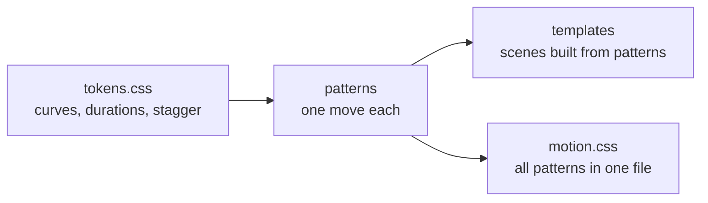

# Principles

Motion on the web is easy to add and easy to get wrong. These rules come from real pages where it went wrong.

## One orchestrated moment per page

A page gets one big entrance, usually the hero. Everything else is a subtle rise, fade or draw, or still. Two big moments compete and both lose.

## Text renders first

The heading and the main image are what people came for and what speed tools measure. Holding them at `opacity: 0` until an animation runs makes the page feel slow and costs Largest Contentful Paint. Animate the decoration around them, or start from a visible state.

## Reduced motion means the finished state

Some people get dizzy or sick from motion, and set `prefers-reduced-motion`. The respectful answer is the page as it looks when the animation ends, not a blank space where hidden content waits for a trigger that never fires.

## No JavaScript, no hidden content

A start state like `opacity: 0` is only applied under `.js`, which `play.js` sets before first paint. If the script fails or is blocked, nothing is stuck invisible.

## CSP-safe by default

Strict Content Security Policies block `style=""` attributes and inline scripts. Every entry uses classes, `data-*` attributes and external files, so it can drop into a locked-down site unchanged. This site runs under that policy itself (see [`site/public/_headers`](../../site/public/_headers)).

## Shared tokens

When every entry uses the same handful of curves and durations, motions combine without looking stitched together. A new curve is a decision recorded in `tokens.css`, not a number typed into one file.

Tokens feed patterns, patterns feed both the templates and the single-file bundle.
