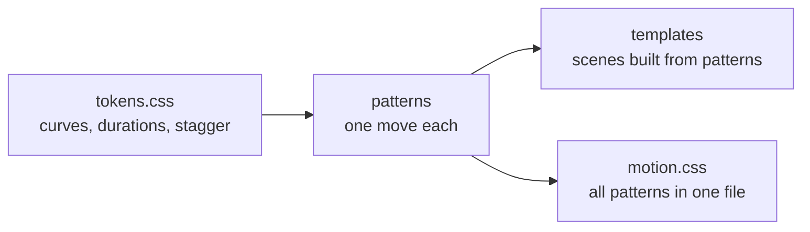

# Principles

Motion on the web is easy to add and easy to get wrong. These rules come from real pages where it went wrong.

## One orchestrated moment per page

A page gets one big entrance, usually the hero. Everything else is a subtle rise, fade or draw, or still. Two big moments compete and both lose.

## Text renders first

The heading and the main image are what people came for and what speed tools measure. Holding them at `opacity: 0` until an animation runs makes the page feel slow and costs Largest Contentful Paint. Animate the decoration around them, or start from a visible state.

## Reduced motion means the finished state

Some people get dizzy or sick from motion, and set `prefers-reduced-motion`. The respectful answer is the page as it looks when the animation ends, not a blank space where hidden content waits for a trigger that never fires.

## Anything that keeps moving can be paused

Motion that starts on its own and runs longer than 5 seconds needs a way to stop it ([WCAG 2.2.2](https://www.w3.org/WAI/WCAG22/Understanding/pause-stop-hide.html)). Hover is not enough: it does nothing on a phone or for a keyboard user. Marquees and crossfades ship a CSS-only pause toggle built on `:has()`, and also pause on focus.

## Heavy things trail the scroll

When every layer of a scroll scene moves in perfect lockstep with the wheel, it feels cheap, like a slide being dragged, and more frames or a smoother scroll do not fix it. Let the heavy parts (a door, a shutter, a hanging sign) ease in a beat behind the scroll position while the camera and the text stay 1:1. The gap between them reads as weight. Keep gauges such as a progress bar locked: a lagging gauge looks broken. See [`scroll-weight`](../../patterns/scroll-weight/).

## Physics you can check

An object that moves the way the real one does is what makes a demo convincing, so the numbers are real: meshed gears turn at speeds set by their tooth counts and opposite ways, a drum snaps to a row after a flick, a panel swings about its hinge edge and shades with its angle, light fades with distance, a pendulum's period follows its length. A wrong ratio or a panel that moves without a hinge is a bug, not a style. See [`gear-processing`](../../patterns/gear-processing/) and [`drum-time-picker`](../../patterns/drum-time-picker/).

## One real job per entry

Every object-family entry shows the motion doing one job on a believable screen, with specific names and numbers (RM 86.40, 7:45 pm, 23 seats left), and no job appears twice in the collection. A demo nobody would ship teaches nothing about where the motion belongs; the `Use when:` line at the top of each README says where it does.

## Motion adds to what is there

Where an entry moves an element, it uses the individual `translate`, `rotate` and `scale` properties when it can, so it sits on top of the element's own `transform` (a stamp's tilt, a card's rotation) instead of replacing it.

## No JavaScript, no hidden content

A start state like `opacity: 0` is only applied under `.js`, which `play.js` sets before first paint. If the script fails or is blocked, nothing is stuck invisible.

## CSP-safe by default

Strict Content Security Policies block `style=""` attributes and inline scripts. Every entry uses classes, `data-*` attributes and external files, so it can drop into a locked-down site unchanged. This site runs under that policy itself (see [`site/public/_headers`](../../site/public/_headers)).

## Shared tokens

When every entry uses the same handful of curves and durations, motions combine without looking stitched together. A new curve is a decision recorded in `tokens.css`, not a number typed into one file.

Tokens feed patterns, patterns feed both the templates and the single-file bundle.
