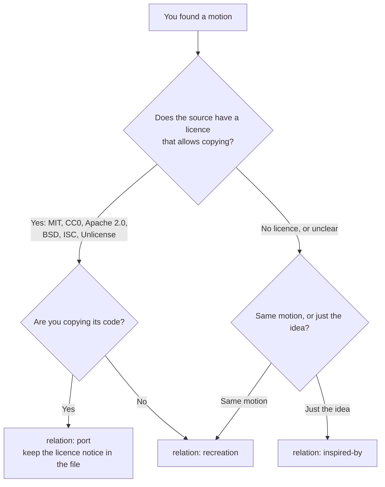

# Credit a source

Most entries come from motions seen elsewhere: a post, a video, a pen, a site. This page decides how one comes in.



No licence means all rights reserved, so the only ways in are a recreation or an inspired-by entry, both written from scratch.

## Rules

- **Never copy code, images, fonts or text from a source without a licence that allows it.** Watching it and rebuilding the movement from scratch is fine.
- **Always link the source.** `source.url` must be an https link to the original post or page, `source.author` the handle or name shown there.
- **Write down what the licence says**, even when it says nothing: `"licence": "none stated"`.
- **A port keeps the original notice** as a comment at the top of the copied file.
- **Use `source.notes`** for anything a reader should know, such as "the source is a video prompt; this is a CSS build".

## Example

```json
"relation": "recreation",
"source": {
  "title": "Card stack shuffle",
  "author": "@someone",
  "url": "https://example.com/post/123",
  "licence": "none stated",
  "notes": "Rebuilt in CSS from the video; no code was available."
}
```

## If someone asks for a credit or a removal

Fix the credit, or remove the entry, in the same week. The [credit or removal form](https://github.com/rujilabs/motion-patterns/issues/new?template=credit-or-removal.yml) is linked from the gallery footer.
